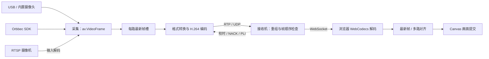
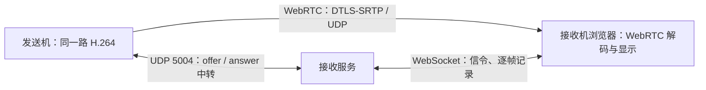

# 多路摄像头低延迟视频回传

通过局域网将多路摄像头画面单向传到接收机，使用 Vue 3 控制发送、接收与预览，记录延迟、帧率、码率和画面同步偏差。媒体采用 H.264 / RTP / UDP，接收端回传校时、关键帧请求及限时重传反馈。


## 分支

| 分支 | 内容 |
|---|---|
| `main` | 通用部分：采集、编码、RTP / WebRTC 传输与公网鲁棒性、接收页 |
| `dog-control` | 中狗 D1 Max 机器狗：RK3588 轻量发送端、运动控制、NetBird 转发部署 |
| `ti5-control` | 钛虎 T170C：机器人端 ROS 2 控制桥与接收页控制面板 |

通用改动先提交到 `main`，机器人分支合并 `main` 跟上；只给某台机器人用的代码只放在它的分支。

## 功能与数据流

- 支持 1–8 路输入：内置/USB 摄像头、提供 RTSP 的网络或 PoE 摄像机、Orbbec SDK v2 图像流，可混合使用。
- 可选采集模式，统一设置输出分辨率、帧率上限及每路目标码率；默认输出 1280×720、30fps、3000kbps/路。
- 原始帧槽只保留最新一帧；编码禁用 B 帧和前瞻，接收端限制重组、解码和显示队列长度。
- 提供逐路最新帧显示、多路软件对齐、运行数据导出。
- 接收画面显示发送端的摄像头名称，RTP / WebRTC 均支持；同名设备附加路号。网络摄像机优先使用配置中的 `label`，否则显示主机地址，不显示连接凭据。旧发送端未提供名称时显示“摄像头 1、2”。
- 可选 WebRTC 对照传输：发送端用 aiortc 把同一路 H.264 直接发给接收机浏览器，便于与当前 RTP 链路同条件比较，见下文“WebRTC 对照传输”。
- 业务代码只接受摄像头输入，已移除自绘测试画面及 `--source` 选项。



这是默认 Vue 链路。CLI 接收模式也可在 Python 中解码，通过其他方式接收数据。网络摄像机目前先解码再重新编码，尚未实现压缩码流直通。深度流传输的是可视化图像，不能作为原始深度数据使用。

## 安装与启动

macOS / Linux，首次克隆并建立环境：

```bash
git clone https://github.com/bulichuchu/low_latency_video_transmit.git
cd low_latency_video_transmit
python3 -m venv .venv
.venv/bin/python -m pip install -r requirements.txt

运行环境自检
.venv/bin/python demo.py doctor

启动程序
.venv/bin/python demo.py web --no-browser
```

已有仓库时直接进入项目目录，无需再次克隆。已验证的 Python 环境为 3.13。Windows PowerShell 可用以下命令建立环境；其他命令中的 Python 路径相应替换：

```powershell
py -3.13 -m venv .venv
.\.venv\Scripts\python.exe -m pip install -r requirements.txt
.\.venv\Scripts\python.exe demo.py web --no-browser
```

仓库包含 `frontend/dist/`，正常使用不需要 Node.js。PyAV wheel 自带媒体库，无需单独安装 FFmpeg 命令行程序。`doctor` 只检查运行环境和编解码器初始化，不采集或生成视频，也不验证实际画质、帧率与延迟。

启动后打开：

- [发送端](http://127.0.0.1:8765/#/sender)：选择摄像头，配置输出画质、接收机地址和 UDP 端口。
- [接收端](http://127.0.0.1:8765/#/receiver)：配置接收路数、UDP 端口和显示策略，点击“开始接收”。

macOS 也可使用 `start_demo.command`、`start_sender.command`、`start_receiver.command`；Windows 使用对应 `.bat`。`start_demo` 无参数打开 Vue，有媒体参数时进行无窗口 CLI 联调。启动网页服务不会自动开始采集；“本机联调”会启动本机的接收与发送。

macOS 上 `start_sender.command` 和无参数的 `start_demo.command` 启动时会请求一次管理员密码：发送到其他电脑期间临时关闭 AWDL（隔空投送、接力、通用控制、随航随之暂停），停止发送或退出服务后自动恢复，原因见[常见排查](#常见排查)。不需要时用 `KEEP_AWDL=1 ./start_sender.command` 启动。

若希望 AWDL 和 `start_sdk_helper.command` 自动完成管理员授权，可在 `.local/sudo-password` 的第一行填写本机管理员密码（纯文本，末尾换行，无需引号或变量名）。该文件保存在已被 Git 忽略的 `.local/` 目录，权限应为 `600`，目录权限为 `700`。启动脚本仅将文件作为 `sudo` 的标准输入，密码不放进命令参数或环境变量；文件缺失、为空或授权失败时仍可手动输入。删除文件即可恢复每次手动授权。

接收浏览器需要支持 H.264 WebCodecs，预览要求安全上下文：本机回环 HTTP 或受信任的 HTTPS。一个接收会话支持一个活动预览页面。关闭页面不会停止传输，需点击停止按钮或在服务终端按 Ctrl+C。画质设置在下次启动采集时生效。

本地采集后端为 macOS AVFoundation、Windows DirectShow、Linux V4L2。macOS 模式查询使用系统 Swift / Apple Command Line Tools；Linux 可通过 `v4l2-ctl` 提供模式信息。Windows、Linux 和具体设备模式仍需在目标机器验证。

## 两台机器部署

机器人上的发送端和运动控制在各机器人分支（见上文“分支”）。下面的“两端安装仓库”适用于通用桌面发送端。

两端使用相同版本的仓库，各自安装 Python 依赖。先在接收机运行：

```bash
.venv/bin/python demo.py web --page receiver --no-browser
```

在接收机本地浏览器打开接收页，设置监听地址 `0.0.0.0`、UDP 端口 `5004`、正确的视频路数，选择“两台设备 · 自动估计”，点击“开始接收”。再在发送机启动 Web 服务、选择摄像头，将接收机地址填为接收机的 IPv4 地址或可解析的域名，例如 `192.168.1.20`。地址栏不要包含 `http://`、路径或端口；端口单独填写。

| 连接 | 默认端口 | 用途 |
|---|---|---|
| 浏览器 → Web 服务 | TCP 8765 | 页面、控制、WebSocket 预览 |
| 发送机 → 接收机 | UDP 5004 | 视频及发送端对校时探测的回复 |
| 接收机 → 发送机 | 发送端临时 UDP 端口 | 校时探测、关键帧与重传请求 |
| 发送机 ↔ 接收页浏览器 | ICE 选定的临时 UDP 端口 | 仅 WebRTC 模式：视频、校时数据通道与 RTCP |

Web 默认只监听 `127.0.0.1`，这与 UDP 视频监听地址是两项设置。放行防火墙不会让仅监听回环的 Web 服务变成网络监听。跨机媒体需要接收机允许 UDP 入站，双方允许反馈返回；当前媒体协议用于可信网络，没有 SRTP、NAT 穿透或完整拥塞控制。

跨公网（如 NetBird）时接收端按往返时延自动调整，局域网（往返几毫秒）保持原样：

- 校时探测每 0.2 秒测一次往返，取最近 5 秒的中位数。链路拥塞时回复会晚几秒甚至不来（10-21 实测 2–9 秒）：超过 1 秒没有回复，往返按最早那个未回复探测已经等了多久计，不再当成“未知”而退回局域网设置。
- 组包等待从局域网的 P 帧 20 ms / IDR 50 ms 放宽到 2 × 往返 + 10 ms / 3 × 往返 + 30 ms（最多 150 / 200 ms），够丢一个包后补发一次；接收页“组包等待（最少）”是 P 帧的下限。窗口从这一帧最后一次收到新分片时起算：窄链路上一个大 IDR 光传过来就要几百毫秒（1.5 Mbps 时 50 KB 约 270 ms），仍等它收完。
- NACK 先等四分之一个往返（短暂乱序常见），同一个包隔一个往返才再要；补发赶不上窗口时不再请求。
- 缺的那一帧（或它后面的 IDR）还在组包时，解码线程等它再往下走；能直接跳到 IDR 时不再另要 IDR。
- IDR 连续收不齐时 PLI 退避：间隔从 150 ms + 2 × 往返起每次加倍，最长 2 秒，收齐一个关键帧后复位。10-16 公网实测，失败的 IDR 引来更多 IDR，一路最多每秒 9.5 个。
- 显示的帧龄上限（CLI 和网页对齐模式）加上两个往返（往返按最多 150 ms 计）。网页最新帧模式不再因超龄丢帧：迟到的帧也比画面上停着的那帧新。
- 网页最新帧模式的播放缓冲：往返 ≥ 12 ms 时帧常成串到达，直接显示会一次跳过好几帧。每帧按“采集时刻 + 最近 4 秒最小时延 + 余量”显示，余量取最近 4 秒到达抖动的 90% 分位、最多 100 ms，抖动变大立即加大、变小每秒减 20 ms；比这还晚的帧到达即显示。用 10-21 公网实测的到达时刻回放：显示的帧从 87% 到 97%，超过 100 ms 的画面停顿少约六成，平均多约 23 ms 延迟。每路的“播放缓冲”格显示当前余量；“时钟与缓冲设置 → 播放缓冲”可关闭（CLI `--rtp-playout min`）。局域网不缓冲。
- 往返时延随校时探测发给发送端，机器人发送端据此调整发送（如 `dog-control` 分支的 RK 发送端：按节拍发 IDR、限制强制 IDR、按丢包和排队时延降码率和帧率）。发送端在校时回复里报当前码率和帧率（`stream_rates`）时，接收页每路标题旁显示，低于设置时页面提示。桌面发送端忽略这些。
- 丢包怎么算（10-21 晚起）：接收端每 0.2 秒随校时探测报每路两项累计给发送端（`resent`、`missing`）。`resent` 是要过重传、请求后 3/4 个往返原包仍没到的包（当时就计，不等重传到）；`missing` 是没要过、比它新的包到了半秒后仍没到的包；另报 `unrepaired`（要过、最后也没到的，供发送端在短链路上只算真正没到的包）。超过 1 秒的整段中断前后要过或跳过的都不算（那是断网，往返已经反映）。请求后很快就到的包只是乱序或排队晚到，不算丢包：10-21 下午机器狗上行被请求的帧约四分之三是这样，按第一次请求算丢包的发送端（RK 0.6）46% 的时间降了帧率（32% 在 10 fps）。`events.jsonl` 每秒的 `sample` 里有 `resent`、`nack_late`（晚到的）、`missing`。
- 链路停顿（10-21 晚起）：一路一段时间收不到任何包（30 fps 时 100 ms；帧率低时是 3 个帧间隔，最多 400 ms），按链路停了处理：组包窗口暂停计时，停顿后到的包接着把帧组完（10-21：上行停了 1.4 秒，正在组的 IDR 超时，停顿后它的包全到了，后面 29 帧却都等下一个 IDR）。窗口恰在停顿开始时到期、之后包又来的帧，3 秒内且后面没有帧组完时重新组装（`frame_revived`）。帧过期时后面已有组完的 IDR，就不再要 IDR。
- 校时（10-21 晚起）：链路拥塞、5 秒内没有往返 200 ms 以内的校时样本时，沿用上一次的时钟估计最多 60 秒，不确定度每秒加 0.1 ms（100 ppm）。原来这时每帧延迟都“未知”，正是画面落后几秒的时候。
- 网页（10-21 晚起）：停顿后成串到达的帧照常解码，不再重置（原来解码队列超过 3 帧、接收服务给网页的队列满 3 帧就丢掉重来，等下一个 IDR）。解码器拿到较新的帧后 0.5 秒（局域网 0.25 秒）仍交不出最早那帧、或积压 60 帧，才重新开始；接收服务给网页的队列在最早一帧排了 0.3 秒（局域网 0.15 秒）或攒到 64 帧时才清空重来，IDR 到达时丢掉同一路排在它前面的帧（`bridge_superseded_by_idr`），画面直接跳到最新。画面比实际晚 1 秒以上时，右上角显示“画面延迟 X.X 秒”。
- 发送端信标（`rk_beacon`）：链路不通时机器人发送端可以只发 IDR，并定时发一个很小的信标。接收端收到信标就开始校时，新开的接收端不必等下一个 IDR；当前发送端的信标也表示它还在，别的发送端不能借机接管。

### 从另一台电脑打开接收页

接收机已启用 SSH 时，可保持 Web 服务只监听回环，在查看页面的电脑运行：

```bash
ssh -N -o ExitOnForwardFailure=yes \
  -L 127.0.0.1:18765:127.0.0.1:8765 \
  user@receiver.local
```

将 `user@receiver.local` 替换为接收机的 SSH 用户和地址。登录成功后终端保持无输出是正常的，需保持连接。浏览器打开 [转发后的接收页](http://127.0.0.1:18765/#/receiver)。SSH 只转发这里的 Web TCP 连接，视频的 UDP 5004 仍需直接互通。

如果直接通过域名访问，可在接收机显式设置监听和 Host 白名单；下面示例还为浏览器视频预览启用 HTTPS：

```bash
.venv/bin/python demo.py web --bind 0.0.0.0 \
  --allow-host receiver.local --port 8765 \
  --tls-cert /path/to/fullchain.pem --tls-key /path/to/privkey.pem \
  --page receiver --no-browser
```

域名、证书和私钥需替换为实际配置，证书必须覆盖域名并受浏览器信任。去掉 TLS 参数后是 HTTP 控制页面，远程域名 HTTP 无法满足视频预览的安全上下文要求。`--allow-host` 可重复指定；它是 Host 白名单，不是账号登录，仅应向可信客户端开放控制服务。

通过远程页面观看时，链路为“摄像头 → 发送机 → 接收机 → 当前浏览器”，显示延迟还包含最后一段传输。页面中的摄像头枚举与 SDK 路径属于运行 Web 服务的机器。

## WebRTC 对照传输（可选）

用于和当前 UDP/RTP 链路同条件对比：采集、编码器、码率与逐帧计时完全相同，只把“编码完成 → 浏览器”换成 WebRTC。



- 发送端用 aiortc 把已编码的 H.264 帧直接发给打开接收页的浏览器，不重新编码；浏览器连上之前和断开之后仍发 RTP。接收服务只经原 UDP 端口中转连接信令，并记录浏览器回报的逐帧数据，不经手视频。
- 只有发送机需要 aiortc，`start_sender.command` 首次启动时自动安装。手动安装：

  ```bash
  .venv/bin/python -m pip install -r requirements-webrtc.txt
  .venv/bin/python -m pip install --no-deps aiortc==1.15.0
  ```

  aiortc 声明 `av<18`；本项目只交给它已编码的帧，已与 PyAV 18 一起测试，`pip check` 的这条提示可忽略。
- 使用：接收页“传输方式”选“WebRTC · 发送端直连浏览器”，“WebRTC 渲染”保持“最低延迟 · playout-delay 0”，开始接收；发送端照常开始发送，地址和端口不变。连上后发送页各路显示 WebRTC，断开后自动恢复 RTP。
- 对比时接收页必须在**接收机本机**的 Chrome / Edge 打开（接显示器或屏幕共享均可）。经 SSH 隧道在发送机上打开时，WebRTC 视频走发送机本机回环，页面会提示，结果不可比。RTP 方案也请在接收机本机打开接收页再测一次。
- 计时口径一致：两种方式的总延迟都止于“该帧首次出现在页面刷新中”（RTP：刷新回调中画完；WebRTC：requestVideoFrameCallback 回调），都不含之后合成上屏的约一帧。WebRTC 第 3 段“网络 → 浏览器”对应 RTP 第 3、4 段之和；发送端经 WebRTC 数据通道直接与页面校时。
- “浏览器默认 · 自适应缓冲”保留 Chrome 的抖动缓冲，用来观察普通 WebRTC 应用的延迟；本机回环实测其缓冲约 40–50 ms，最低延迟模式约 0.3 ms。
- 发送机与接收机浏览器之间需要 UDP 直通，不使用 STUN / TURN。Chrome 用 mDNS 名称隐藏本机地址；发送端先尝试解析，解析不到时由浏览器的连通性检查得到其地址。
- WebRTC 的 UDP 包与 RTP 方案一样不超过发送端 `--mtu`（默认 1200 字节）。接收页路数少于发送端时只协商页面需要的路，其余仍走 RTP 并由接收端丢弃，与 RTP 模式一致。
- 停止后两种方式的 `summary.json` 可直接对照：`sensor_to_browser_submit_ms`、`browser_submit_latency_ms`，以及 `stages_ms` 中依次相加等于总延迟的 `camera_ms`、`sender_ms`、`delivery_ms`（编码完成 → 浏览器收齐）、`browser_ms`（收齐 → 显示）。`browser_ms` 内部的拆分两边不同：RTP 的 `browser_decode_ms` 含 WebCodecs 排队，`browser_wait_ms` 是解码后等刷新；WebRTC 的解码只算解码本身，抖动缓冲与等刷新都在 `browser_wait_ms` 中（抖动缓冲另记 `browser_buffer_ms`）。WebRTC 另有 `webrtc`（丢包、NACK、PLI、卡顿等 getStats 数据）；发送端有 `tx_by_transport`、`process_cpu_percent` 和每帧 `webrtc_tx`（aiortc 排队与发送耗时）。

## 摄像头配置

### 内置 / USB 摄像头

Vue 中刷新设备并选择实际列出的模式，也可使用 CLI：

```bash
.venv/bin/python demo.py cameras
.venv/bin/python demo.py demo --cameras "摄像头名称" --width 1280 --height 720 --fps 30
# 两路设备，编号以本次 cameras 查询为准
.venv/bin/python demo.py demo --cameras 0,1 --sync-mode latest
```

macOS 支持设备名称/编号，Windows 使用 DirectShow 名称，Linux 使用 `/dev/video0` 等路径。`send` 和 `demo` 必须指定摄像头；需要交互选择时运行 `web`，在 Vue 发送页配置。

默认 `--capture-mode auto` 根据设备能力选择接近目标的采集模式。`exact` 或逐相机显式参数要求设备支持该组合。输出宽高必须为偶数；输出 FPS 是上限，不会补出相机未采到的帧。没有可查询模式的后端可手动填写，但需启动采集验证。

逐相机配置可保存为 `cameras.json`：

```json
{
  "version": 1,
  "output": {"width": 1280, "height": 720, "fps": 30, "bitrate_kbps": 3000},
  "cameras": [
    {"device": "设备 A", "width": 1280, "height": 720, "fps": 60, "pixel_format": "nv12"},
    {"device": "设备 B", "width": 1280, "height": 720, "fps": 30, "pixel_format": "nv12"}
  ]
}
```

运行 `.venv/bin/python demo.py demo --camera-profile cameras.json`。本地/SDK 逐路配置控制采集模式，顶层 `output` 控制传输输出；命令行输出参数可覆盖配置文件的输出值。不同输入统一缩放为输出尺寸，优先选择相同比例以避免拉伸。

### PoE / RTSP 网络摄像机

PoE 描述供电方式，视频接入要求摄像机实际提供 RTSP 地址。先给相机供电、配置网络并开启 RTSP，在发送页每行填写一个地址，或执行：

```bash
.venv/bin/python demo.py demo --rtsp-url 'rtsp://192.168.1.100:554/实际视频路径'
# 网络与本地相机混用；多个网络输入重复添加 --rtsp-url
.venv/bin/python demo.py demo --cameras 0 \
  --rtsp-url 'rtsp://192.168.1.100:554/实际视频路径'
```

默认 RTSP 使用 TCP，可用 `--rtsp-transport udp` 对照。各路连接独立超时和重连。相机原始分辨率、帧率、码率在相机后台配置；本程序设置的是输入解码后的重编码输出。目前不提供 ONVIF 自动发现或 PTZ 控制。

账号可放在 URL 中，也可通过环境变量传给[网络摄像机配置示例](docs/examples/network-cameras.json)：

```bash
export POE_CAMERA_1_URL='rtsp://用户名:密码@192.168.1.100:554/实际视频路径'
.venv/bin/python demo.py demo --camera-profile docs/examples/network-cameras.json
```

生成的配置、日志和报告会隐藏 RTSP 凭据。逐路可配置 `rtsp_transport`、`open_timeout_s`、`read_timeout_s`、`retry_delay_s`，不接受用逐路 width/height/fps 控制网络相机。

### Orbbec SDK 摄像头

发送机需安装匹配平台、架构和设备的 Orbbec SDK v2，完整保留动态库及配套文件；接收机不需要 SDK。在 Vue 的“厂商 SDK · Orbbec”中登记目录并查询，或运行：

```bash
.venv/bin/python demo.py sdk --orbbec-root '/实际/OrbbecSDK_v2目录'
.venv/bin/python demo.py cameras --sdk
.venv/bin/python demo.py demo --cameras 'orbbec://实际序列号/color'
```

也可设置 `ORBBEC_SDK_ROOT`。本机路径保存在 `.local/`，不通过 Git 同步。当前适配器读取设备实际提供的彩色、红外或深度预览模式；同一物理 SDK 设备一次选择一种图像流，不同设备可并行。其他厂商需要新增适配器。

macOS SDK 直连报 `uvc_open ... -3` 时，可在接相机的电脑运行 `./start_sdk_helper.command`，在终端完成管理员授权并保持助手运行，Web 服务继续以普通用户运行。助手就绪不等于设备取图成功；仍需实际查询和收帧。同一相机不要同时被系统 UVC、SDK 或其他应用采集。

当前助手版本为 `shared-memory-v5`：解码后的图像经共享内存交给发送进程，socket 只传帧头（macOS 本机 socket 缓冲只有 8 KB，原先一帧 720p 要分数百段传）。支持 Global Timestamp 的设备会在采集前启用该功能，经稳定性检查后映射到发送机时钟。更新 SDK 助手代码或路径后需停止采集、重启助手，再查询设备。SDK 时间戳与实际曝光的关系、映射误差仍需设备级标定。

## 延迟、帧率与多路对齐

接收页每路显示总延迟和按链路顺序的六段，全部取**最近提交的同一帧**，六段相加等于总延迟：

| 段 | 含义 |
|---|---|
| 1 相机采集 → 应用取帧 | 曝光、读出、USB 与驱动；需要相机时间戳 |
| 2 发送端处理 | 应用取帧 → 编码完成：传帧、格式转换与 H.264 编码 |
| 3 网络 → 接收端 | 编码完成 → 接收端转发：发包、网络与组帧 |
| 4 接收端 → 浏览器 | WebSocket 预览连接，经 SSH 访问时包含隧道 |
| 5 浏览器解码 | WebCodecs 解码 |
| 6 等待刷新与绘制 | 解码完成到下一次屏幕刷新时绘制；对齐模式含等待其他路，公网播放缓冲时含缓冲 |

另有显示帧率（实际提交的新帧速率）和可见画面同步偏差（同屏各路已显示帧的应用取帧时间戳跨度）。

计时起点优先使用相机时间戳：Orbbec SDK 的 Global Timestamp，或 macOS AVFoundation / Linux V4L2 随帧给出、与本机单调时钟同源的时间戳（代表曝光、读出还是到达主机随设备与驱动而异，未标定）；都不可用时（如 Windows DirectShow）明确回退为应用取帧。RTSP 从发送机完成输入解码起算，不包含之前的相机编码、输入网络和输入解码。跨机时钟使用四时间戳估计；`shared` 仅能用于同一台电脑，校时不可用时显示未知。

第 3、4 段的分界依赖接收机与浏览器之间的时钟估计（误差约为半个往返时间），两段之和可靠；其余各段在同一台机器的时钟内计算。总延迟的终点是浏览器提交画面，不含屏幕扫描和像素响应。

Vue 默认 `latest`，逐路显示最新帧；CLI 测量默认 `aligned`。对齐模式按应用取帧时间戳选取接近共同目标的帧，在容差内等齐各路，超过等待预算后允许部分路更新，其余保留旧帧。Vue 默认等待 8ms、容差 18ms；CLI 多路默认等待半帧且最多 20ms。CLI 的 `--strict-sync` 可要求完整组。

当前配帧依据仍是应用取帧时间，尚未改为所有相机的传感器曝光时间。软件对齐不能保证硬件曝光同步，部分路保留旧帧时，同屏实际偏差可能超过配帧容差。

## CLI 与测量记录

CLI 用于无窗口传输和解码测量，实时看画面使用上面的 Vue 接收页。以下命令未设置时长时持续运行，按 Ctrl+C 停止：

```bash
# 接收机
.venv/bin/python demo.py receive --bind 0.0.0.0 --port 5004 --streams 1 \
  --width 1280 --height 720 --fps 30 --clock-mode estimated
# 发送机
.venv/bin/python demo.py send --host 192.168.1.20 --port 5004 \
  --cameras "摄像头名称" --width 1280 --height 720 --fps 30
# 本机固定时长测量，不打开接收窗口
.venv/bin/python demo.py demo --cameras 0,1 --decoder software --duration 30
```

每次会话生成独立 `runs/` 目录，保存 `config.json`、`events.jsonl`、`frames.csv`、`metrics.csv` 和 `summary.json`。发送端记录实际采集模式与取帧率；CLI 本机 demo 还生成双方帧号对照的 `report.json`。Vue 可在停止后下载报告，浏览器提交数据与 Python 解码数据分别统计。

默认不保存摄像头图像；CLI 的 `--save-preview` 可在退出时保存静态 PNG 预览。旧命令中的 `--headless` 仍兼容，无需再显式指定。原始报告保留相机与应用两套时间指标、未知样本及丢弃原因；不要将各阶段 P95 相加作为总 P95。

软件统计终点是画面提交，不包含屏幕扫描与像素响应。项目不再内置外部录像分析工具。

## 开发与更新

| 路径 | 职责 |
|---|---|
| `demo.py`、`video_demo/cli.py` | CLI、参数校验、启动与本机 demo 进程管理 |
| `video_demo/webapp.py` | Vue API、发送/接收会话和 WebSocket 服务 |
| `video_demo/cameras.py` | 通用设备能力与采集配置 |
| `video_demo/sdk.py`、`video_demo/orbbec.py`、`video_demo/sdk_helper.py` | SDK 路由、Orbbec 取图、macOS 助手通信 |
| `video_demo/network.py` | RTSP 输入、重连与凭据脱敏 |
| `video_demo/sender.py`、`video_demo/media.py` | 采集线程、最新帧槽、格式转换、编码和发送 |
| `video_demo/protocol.py` | RTP 元数据、H.264 分包/重组、NACK/PLI/RR |
| `video_demo/receiver.py`、`video_demo/timing.py`、`video_demo/capture_time.py` | 接收调度、校时、CLI 配帧与相机时间戳（SDK 映射、系统相机 PTS） |
| `video_demo/webbridge.py` | 压缩帧与元数据转发给浏览器 |
| `video_demo/webrtc_sender.py`、`webrtc_relay.py`、`webrtc_signal.py`、`frontend/src/media/webrtc.js` | 可选 WebRTC：发送端 aiortc、接收服务信令中转、浏览器播放与计时 |
| `frontend/src/components/` | Vue 发送端、接收端和摄像头配置 |
| `frontend/src/media/` | WebCodecs 解码、浏览器校时、配帧与提交节拍 |
| `video_demo/metrics.py`、`video_demo/preview.py` | 指标报告与可选静态 PNG 预览 |
| `tests/`、`frontend/tests/` | 自动化测试；RTSP 与 SDK 测试夹具仅在此使用 |

```bash
.venv/bin/python -m pip install -r requirements-dev.txt
.venv/bin/python -m pytest -q
cd frontend
npm ci
npm test
npm run build
```

前端开发可运行 `npm run dev`，Vite 将 `/api` 和 WebSocket 请求转到本机 8765 的 Python 服务。日常部署使用已构建的 `frontend/dist/`；前端变更需将源码和新构建产物一起提交。自动化测试使用本机临时端口及测试夹具，不依赖真实摄像头；测试通过不等于真机延迟验收通过。

另一台机器在项目目录执行 `git pull --ff-only` 同步，然后由操作者重启 Web 服务并刷新浏览器。依赖变更时重新安装 requirements；SDK 助手代码变更时重启助手。`.venv/`、`.local/`、`runs/`、`node_modules/` 和 README 之外的 Markdown 文档不随仓库同步，SDK 安装目录在各机器单独配置。

## 常见排查

- **远程网页打不开**：先确认服务是否启动及监听地址。macOS 可执行 `lsof -nP -iTCP:8765 -sTCP:LISTEN`；只监听回环时使用 SSH 转发或显式网络监听，再检查 TCP 防火墙和 Host 白名单。
- **页面能打开但无视频**：确认浏览器 WebCodecs/安全上下文、接收已启动、路数和 UDP 端口匹配。接收码率为零时先查发送地址、网络与 UDP 防火墙。
- **通过 SSH 预览卡顿**：对比接收机本地浏览器，看分段里的“网络 → 接收端”和“接收端 → 浏览器”，以及收到/解码/显示 FPS，区分发送链路与浏览器预览链路。
- **Wi-Fi 下周期性卡顿**：macOS 的 AWDL（隔空投送、接力、通用控制、随航使用的点对点 Wi-Fi）会定时让网卡离开当前信道，实测发送机到接收机每 524ms 停约 100ms。`ping -i 0.1 接收机地址` 每 5 个包出现一次 60–90ms 尖峰即为此现象。`start_sender.command` 和无参数的 `start_demo.command` 已在发送期间自动关闭 AWDL；直接运行命令时用 `tools/awdl_guard.sh .venv/bin/python demo.py web` 启动。异常退出后若隔空投送不可用，执行 `sudo ifconfig awdl0 up`。
- **WebRTC 模式无画面**：接收页提示“尚未收到发送端数据”时先在发送端开始发送并核对目标端口；提示未安装 aiortc 时用 `start_sender.command` 重启发送端；“连接失败”多为两机之间 UDP 不通（防火墙、VPN、访客网络隔离）。浏览器需支持 H.264 WebRTC 接收（Chrome / Edge），一个接收会话同时只服务一个页面。
- **SDK 图像源缺失或助手断开**：查看设备查询错误和助手终端，确认 SDK 路径、助手版本、设备占用与所选模式；助手在线不代表设备已成功采集。
- **延迟未知或异常**：跨机使用自动估计并等待校时，确认两端代码及协议一致。相机采集时间不可用时查看应用链路指标，物理总延迟用光学测量确认。
- **公网 / VPN 下卡顿或 IDR 收不齐**：接收端 `events.jsonl` 里看 `assembly_window`（按往返放宽后的组包窗口）、`rtcp_pli_sent` 的 `unanswered`（连续未答复的 PLI 数）、每秒 `sample` 的 `path_rtt_ms`、`resent` / `nack_late` / `missing`（真丢、乱序晚到、没要过也没到的包）、`revived`，`frame_revived`、`sender_beacon`、`sender_rate`（发送端报来的当前码率、帧率和原因），`drop` 的 `bridge_superseded_by_idr`，以及 `browser_submit` 的 `browser_buffer_ms`（播放缓冲）。接收页每路标题旁就是发送端当前码率和帧率。链路本身很差时先改善 Wi-Fi 信号，或降低发送端设置。
